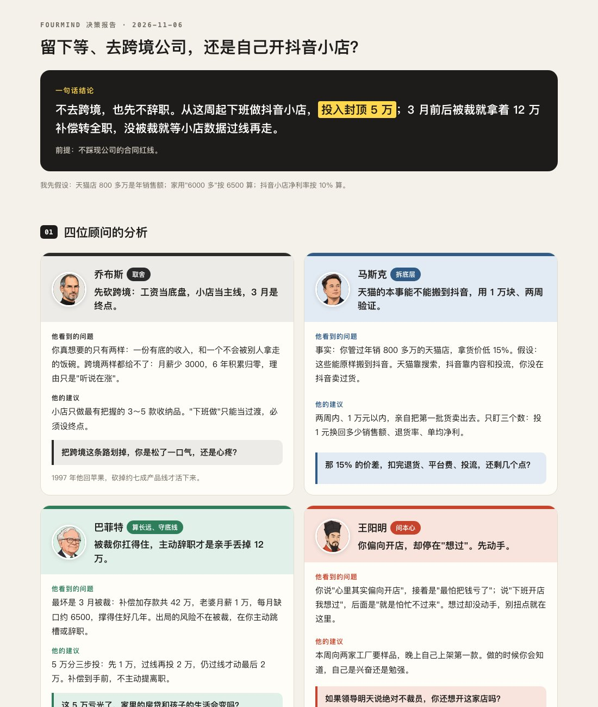
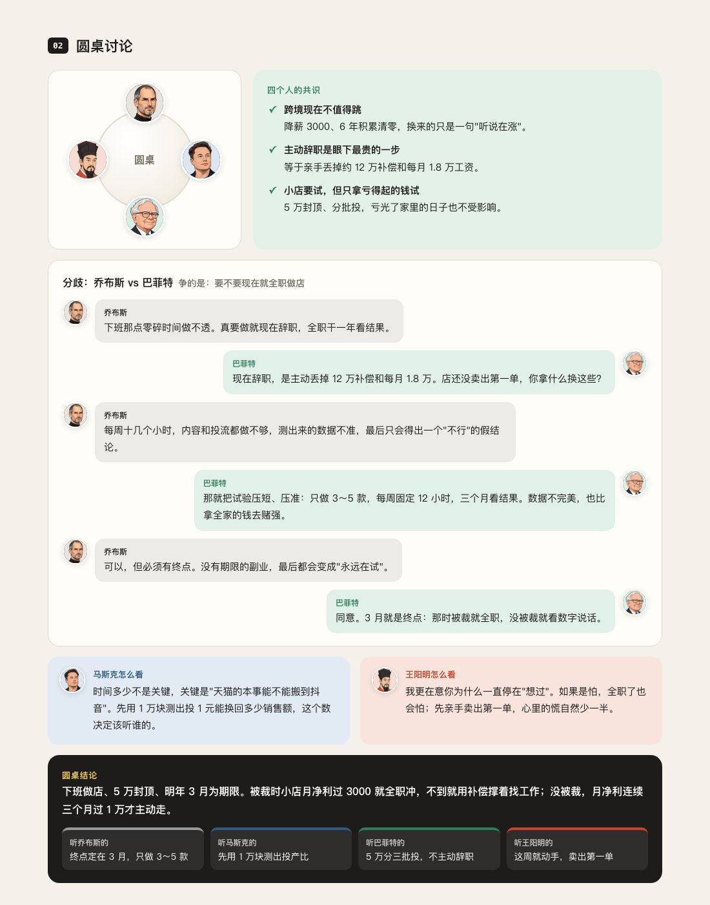
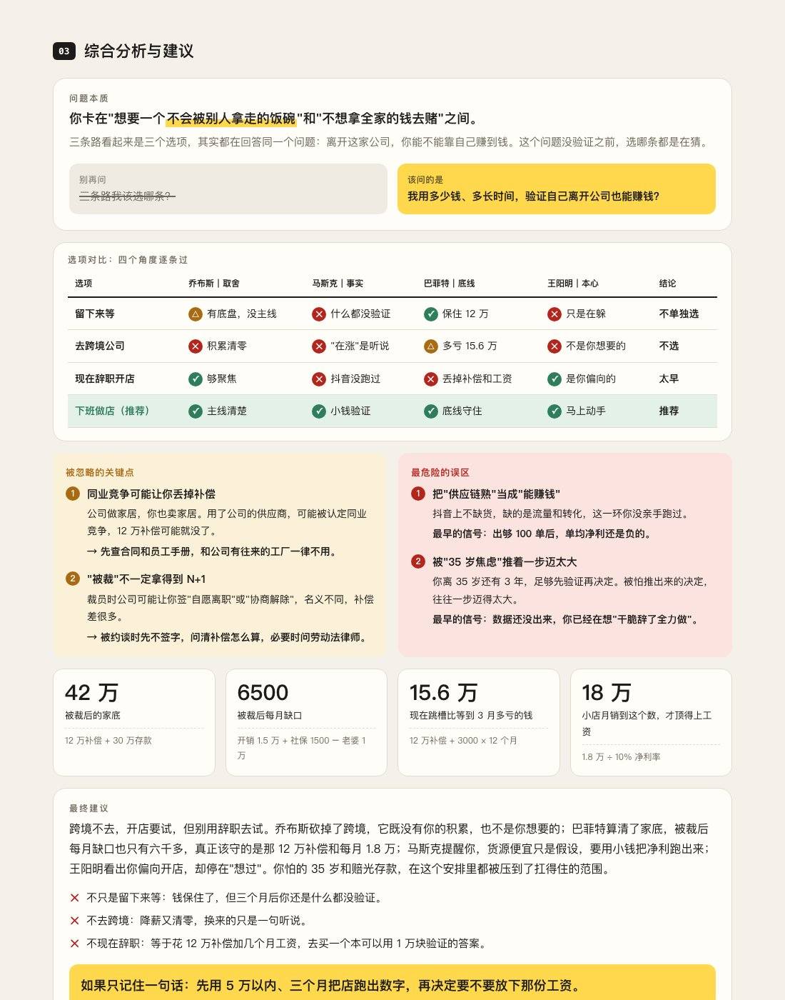
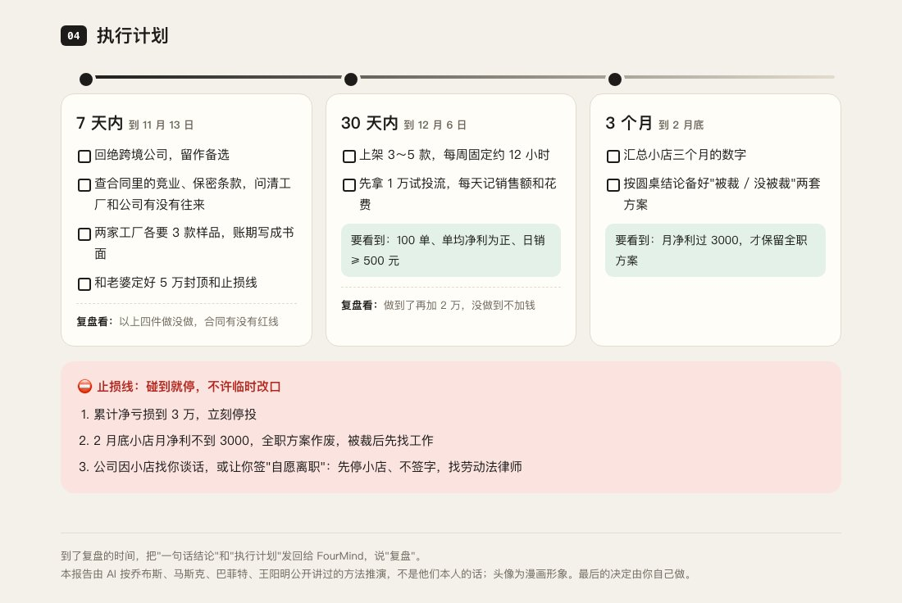

# FourMind · 四人决策

乔布斯、马斯克、巴菲特、王阳明，四个人帮你做决定。

FourMind 是一个 AI 技能（Agent Skill）。把你正在纠结的事告诉它，它会先把你的情况问清楚，再请四位顾问用各自真实的思想方法帮你推演，最后给你一份完整的决策报告：

1. **四位顾问的分析**：每人讲他看到的问题、他的建议、追问你一句
2. **圆桌讨论**：四个人的共识、谁和谁有分歧，最后收拢成一个方案
3. **综合分析与建议**：问题本质、选项对比、你忽略的关键点、最危险的误区、关键数字、最终建议
4. **执行计划**：7 天、30 天、3 个月各做什么，做到哪一步必须停，什么时候回来复盘

在能写文件或能预览网页的 AI 工具里，报告会做成一页可视化网页：



<details>
<summary>展开看完整报告截图（圆桌讨论、综合分析、执行计划）</summary>





</details>

> 截图里的例子：32 岁电商运营经理，公司在裁员，纠结"留下来等、跳去跨境电商、还是自己开抖音小店"。人物和数字都是示例。

## 四位顾问，四个方向

| 顾问 | 方向 | 专治的错 | 他会问你 |
|---|---|---|---|
| 乔布斯 | 取舍 | 什么都想要，舍不得放弃 | 只能留一个，你留哪个？ |
| 马斯克 | 拆底层 | 跟风照搬，被"大家都这么做"带着走 | 哪些是事实，哪些只是你以为？ |
| 巴菲特 | 算长远、守底线 | 只看眼前，不算最坏情况 | 最坏会怎样？你会不会直接出局？ |
| 王阳明 | 问本心 | 自己骗自己，知道答案却不敢做 | 抛开面子，你心里到底想要什么？ |

## 和"让 AI 扮演名人"有什么不一样

- **用方法，不扮演**：技能里附带四个人的资料库，从他们公开的演讲、致股东信、传记和《传习录》里整理出核心思想、真实决策经历、问题清单和盲点。AI 用的是他们做决定的方法，不是模仿他们说话的口气。
- **原话有出处才引用**：资料库里每句话都标了【原话】【流传】【大意】，只有出处可靠的原话才会加引号引用，流传的话不会冒充原话。
- **先反问，再推演**：你只说一句话也没关系，它会先问清楚你手上有多少钱、最坏会怎样、你最怕什么，再开始分析。
- **不讨好**：看到算错的账、回避的问题、自我安慰，会直接指出来。
- **有止损线，有复盘**：每份报告都有"碰到就停"的止损线。7 天、30 天后回来复盘，它会对照当初定的标准，告诉你继续、调整还是停止，不许临时改口。

## 适合什么问题

工作、副业、花钱、感情、家庭、学业里的各种"要不要、选哪个"：跳槽、辞职、转行、创业、做副业、接合作、考研、考公、分手、结婚、换城市、买房……

心里难受、只想倾诉时，它不会硬开会，会先陪你聊；问"怎么做"时，它只请最相关的一两位顾问给方法。

## 安装

### 电脑：支持技能（Skills）的 AI 工具

适用于 WorkBuddy、豆包电脑版、Claude 等支持导入技能的工具。

1. 到 [Releases](../../releases) 下载 `FourMind.zip`，**不用解压**
2. 打开 AI 工具，把压缩包拖进对话框，说："帮我导入这个技能"
   - 工具有"技能"菜单的，也可以在菜单里选"上传技能"
3. 装好后直接说你在纠结的事，比如："我想辞职全职做小红书店铺，去不去？"

**Claude Code**：把本仓库的 `fourmind/` 文件夹复制到 `~/.claude/skills/` 下即可。

### 手机：任何 AI App

豆包、DeepSeek、Kimi、元宝等都能用（手机版是精简版，只出文字报告）。

1. 打开 [`手机通用版提示词.txt`](手机通用版提示词.txt)，全选复制
2. 在 AI 里新开一个对话，粘贴发送
3. 它回复"FourMind 已就位"后，说你在纠结的事

## 怎么问效果最好

- **一句大白话就够**，说不清也没关系，它会先反过来问你
- **回答越具体越好**，有数字就说数字。可以用语音输入，想到什么说什么
- 推演完可以接着问：单独和某一位顾问深聊、模拟最坏情况、换个选项再推一遍

## 记得回来复盘

1. 把报告里的"一句话结论"和"执行计划"复制保存好（备忘录、截图都行）
2. 到了复盘的时间，打开 FourMind，把这两段发过去，说"复盘"，再告诉它结果：该做的事做了没有、数字是多少
3. 它会对照当初定的止损线，告诉你继续、调整还是停止

## 目录

```
fourmind/
├── SKILL.md                  技能主文件：流程、输出格式、自检、复盘、边界
├── references/
│   ├── jobs.md               乔布斯：核心思想、原话出处、真实决策、问题清单、盲点
│   ├── musk.md               马斯克
│   ├── buffett.md            巴菲特（含芒格的"反过来想"）
│   ├── wangyangming.md       王阳明
│   └── example.md            一次完整推演和复盘的示范
└── assets/
    ├── report-template.html  可视化报告网页模板（只用 HTML + CSS，不含脚本）
    └── *.jpg                 四位顾问的漫画头像
手机通用版提示词.txt           手机上复制粘贴用的精简版
```

## 说明

- 这是 AI 按四个人公开讲过的方法帮你推演，不是他们本人的观点，也不代表他们推荐本项目。头像为漫画形象。
- 最后的决定由你自己做。涉及具体投资买卖、医疗、法律问题，请再找专业人士确认。
- 如果你正处在情绪危机中，请联系身边信任的人，或拨打全国统一心理援助热线 12356。

## 许可

[MIT](LICENSE)
